# Sauma Arena 🏆

> **Platform Manajemen & Live Score Turnamen Olahraga Komunitas Terpadu**  
> Mengotomatisasi seluruh siklus turnamen: dari registrasi kontingen, plotting jadwal otomatis, live score scorekeeper, klasemen & bagan gugur, tiket QR pintu masuk, hingga penerbitan e-sertifikat ber-QR terverifikasi.

[](package.json)
[](https://nextjs.org/)
[](https://react.dev/)
[](https://tailwindcss.com/)
[](https://www.typescriptlang.org/)
[](https://turbo.build/)
[](LICENSE)

---

## 🌟 Ikhtisar Produk (Product Overview)

**Sauma Arena** dirancang untuk memodernisasi penyelenggaraan turnamen olahraga sekolah dan komunitas amatir di Indonesia. Menggantikan proses manual yang lambat dan rentan salah melalui WhatsApp serta spreadsheet, platform ini menyediakan satu sistem tunggal untuk 3 peran utama: **Panitia Pelaksana (Admin)**, **Wasit & Juri Lapangan (Scorekeeper)**, serta **Peserta & Suporter (Publik)**.

Pada rilis versi `v0.1.0`, Sauma Arena mengusung implementasi turnamen **Milad Matsanega Futsal Competition I (MMFC I 2026)** tingkat SD/MI se-derajat di **Matsanega Futsal Court (Kampus MTsN 1 Kota Malang)**.

---

## 🏛️ Arsitektur Tiga Portal Utama

```mermaid
graph TD
    A[Sauma Arena Platform] --> B[1. Portal Publik Live Score]
    A --> C[2. Admin Back-Office Console]
    A --> D[3. Panel Juri & Wasit Lapangan]

    B --> B1[Realtime Scoreboard & Ticker]
    B --> B2[7 Tab Navigasi Publik]
    B --> B3[Tiket Masuk Digital Ber-QR]
    B --> B4[Kompetisi Best Supporter]

    C --> C1[Ringkasan Metrik Dinamis]
    C --> C2[Master Cabor, Venue & Lapangan]
    C --> C3[Verifikasi Kontingen & Roster Kunci]
    C --> C4[Plotting Jadwal & Live Score Override]
    C --> C5[Bagan Gugur & Klasemen Otomatis]
    C --> C6[Gate Scanner Tiket WebCam]
    C --> C7[Generator E-Sertifikat Ber-QR]
    C --> C8[Spotlight Command Search]

    D --> D1[Pindai Check-In ID Card Atlet]
    D --> D2[Pencatatan Gol, Kartu & Waktu Bersih]
    D --> D3[Pengesahan BAP Digital Resmi]
```



### 1. Portal Publik Turnamen (`/`)
Halaman live score ramah seluler (*mobile-first*) yang dapat diakses bebas tanpa login oleh pemain, wali murid, dan penonton:
- **7 Tab Informasi Lengkap**:
  1. **Info**: Detail tanggal, venue (terintegrasi Google Maps), kontak panitia, dan mitra pendukung.
  2. **Tim Peserta**: Daftar kontingen sekolah, logo resmi, statistik kemenangan, dan roster pemain berstatus sah.
  3. **Jadwal & Hasil**: Kartu skor per hari pertandingan, status *LIVE*, *UPCOMING*, atau *COMPLETED*, serta pencetak gol.
  4. **Klasemen Grup**: Peringkat otomatis (Menang/Seri/Kalah, Selisih Gol, Head-to-Head).
  5. **Bagan Gugur (Bracket Tree)**: Visualisasi babak perempat final, semifinal, dan grand final dengan propagasi pemenang otomatis.
  6. **Statistik**: Peringkat pencetak gol terbanyak (*Top Scorer*), kartu disiplin, serta visualisasi grafik distribusi menit gol (*Goal Minute Line Chart*) & produktivitas tim (*Team Goals Bar Chart*).
  7. **Suporter Terbaik**: Papan nilai kompetisi antarsuporter madrasah (*koreografi*, *yel-yel*, *tertib tribun*, minus sanksi pelanggaran).
- **Pembelian & Klaim Tiket QR**: Pemesanan tiket reguler dan rombongan langsung dengan unduh e-ticket QR Code.

### 2. Admin Back-Office Console (`/admin`)
Dasbor terpusat untuk operator turnamen dan panitia inti:
- **Ringkasan & Statistik**: Metrik jumlah atlet terdaftar, tiket terjual dan hadir di gerbang, pemantauan laga langsung, serta puncak perolehan medali.
- **Data Lapangan**: Konfigurasi cabor (Futsal, Bulutangkis, Basket, Esports), nomor tanding usia, dan master venue lapangan indoor/outdoor.
- **Data Peserta**: Meja verifikasi berkas (NISN, akta kelahiran, surat rekomendasi kepala madrasah), manajemen kunci roster skuad, dan pencetakan ID Card Atlet ber-QR Code.
- **Kelola Laga**: Plotting jadwal pertandingan, kontrol override live score darurat, bagan eliminasi interaktif, dan perhitungan klasemen grup otomatis.
- **Tiket Masuk**: Monitoring kuota tiket tribun, riwayat transaksi, serta *Gate Scanner QR Camera* langsung dari browser ponsel/laptop.
- **Sertifikat Digital**: Desain template piagam ber-QR, distribusi massal otomatis ke atlet dan suporter berprestasi.
- **Pengaturan & Petugas**: Manajemen akun wasit bersertifikasi FFI, konfigurasi banner, dan broadcast pengumuman darurat.
- **Live Spotlight Command Search**: Navigasi pencarian cepat atlet, laga, dan tiket secara instan.

### 3. Panel Juri / Wasit Lapangan (`Scorekeeper App`)
Antarmuka pinggir lapangan yang ringan dan responsif untuk wasit meja dan komisioner:
- **Pemeriksaan Atlet Pra-Laga**: Pindai QR ID Card atlet di pinggir lapangan untuk memvalidasi keabsahan data sebelum *kick-off*.
- **Pencatat Skor Real-Time**: Tombol taktil cepat untuk penambahan gol, kartu kuning, kartu merah, dan pergantian babak (waktu kotor / bersih).
- **Berita Acara Pertandingan (BAP) Digital**: Rekapitulasi otomatis pencetak gol, pelanggaran, dan tanda tangan digital pengesahan wasit utama.

---

## 🛠️ Tumpukan Teknologi (Tech Stack)

| Lapisan | Teknologi | Keterangan |
|---|---|---|
| **Framework** | Next.js 16.4.0 (App Router) | Arsitektur modern dengan Turbopack untuk kompilasi super cepat |
| **Bahasa** | TypeScript 5.x (Strict Mode) | Keamanan tipe penuh pada data turnamen, pertandingan, dan tiket |
| **Library UI** | React 19.3.0 | Server & Client Components terpisah secara optimal |
| **Styling** | Tailwind CSS v4 & Vanilla CSS Tokens | Desain token dinamis: *Plus Jakarta Sans* (Heading), *Inter* (Body), *JetBrains Mono* (Skor/Angka) |
| **Ikon** | Lucide React | Ikon modern, ringan, dan konsisten di seluruh antarmuka |
| **Visualisasi** | SVG & Canvas Custom Charts | Grafik distribusi gol dan bagan pohon eliminasi responsif |

---

## 🚀 Panduan Memulai (Getting Started)

### Prasyarat
- **Node.js**: Versi `18.18.0` atau yang lebih baru (disarankan Node.js 20 LTS)
- **NPM**: Bawaan Node.js (`npm` v9+)

### Instalasi & Menjalankan Lokal

1. **Clone Repositori**:
   ```bash
   git clone https://github.com/ZhangNX221/SaumaArena.git
   cd SaumaArena
   ```

2. **Pasang Dependensi**:
   ```bash
   npm install
   ```

3. **Jalankan Server Pengembangan (Dev Server)**:
   ```bash
   npm run dev
   ```
   Aplikasi akan berjalan secara lokal di: **`http://localhost:3060`**

4. **Validasi Build Produksi**:
   ```bash
   npm run build
   npm start
   ```

---

## 📁 Struktur Direktori Proyek

```text
SaumaArena/
├── src/
│   ├── app/                      # Next.js App Router (page.tsx, layout.tsx, globals.css)
│   ├── components/
│   │   ├── admin/                # Konsol Admin Back-Office
│   │   │   ├── common/           # Komponen bersama (ConfirmModal, CrudToolbar)
│   │   │   ├── modules/          # Modul domain (Overview, Peserta, Laga, Tiket, Sertifikat, Sistem)
│   │   │   ├── AdminDashboard.tsx
│   │   │   └── AdminSidebar.tsx
│   │   ├── public/               # Portal Publik Live Score & Jadwal
│   │   │   ├── stats/            # Komponen grafik & analitik
│   │   │   ├── tabs/             # 7 Tab Publik (Info, Tim, Jadwal, Klasemen, Bracket, dsb.)
│   │   │   ├── ticket/           # Alur klaim tiket QR
│   │   │   └── PublicHeader.tsx
│   │   └── referee/              # Panel Wasit & Juri Lapangan (Scorekeeper, BAP)
│   ├── mocks/                    # Mock data terisolasi & teruji (MMFC I Matsanega SD/MI)
│   │   ├── mockTeams.ts
│   │   ├── multiSportData.ts
│   │   └── tournamentData.ts
│   └── types/                    # Definisi tipe TypeScript terstruktur
├── docs/                         # Dokumentasi PRD & Arsitektur
│   └── prd/
├── public/                       # Aset statis & logo
├── package.json
├── tsconfig.json
└── README.md
```

---

## 🎨 Standar Desain & Aksesibilitas

- **Prinsip Bebas Slop (*Anti-Slop AI Directive*)**: Menghindari elemen template kaku; seluruh ritme visual didesain atletik, tegas, dan lapang dengan padding `p-6` serta sudut lengkung `rounded-2xl`.
- **Tipografi Sporty**:
  - Judul / Display: `Plus Jakarta Sans` dengan tracking rapat (*tracking-tight*).
  - Angka, Skor & Waktu: `JetBrains Mono` dengan kelas `tabular-nums` untuk perataan angka vertikal presisi.
  - Teks Isi / Keterangan: `Inter` untuk keterbacaan tinggi di kondisi luar ruangan (*outdoor*).
- **Aksesibilitas (WCAG 2.1 AA)**: Dilengkapi `aria-label`, dialog `role="dialog"` dengan pendengar tombol `Escape`, dan kontras warna yang ramah mata.

---

## 📄 Lisensi (License)

Hak Cipta © 2026 **SaumaDev**. Seluruh hak cipta dilindungi undang-undang.  
Didistribusikan di bawah lisensi [MIT](LICENSE).
