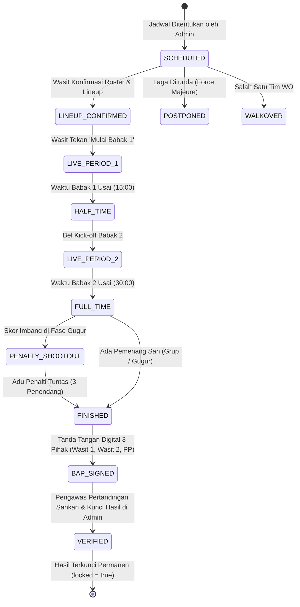

# 04. Mesin Aturan, Template Cabor & State Machine (Technical Rules Engine)

**Dokumen PRD — Bagian 4/12**  
**Produk:** Sauma Arena (Platform Manajemen Pertandingan Multi-Cabang Olahraga)  
**Edisi Turnamen:** Milad Matsanega Futsal Competition I (MMFC I) • MTsN 3 Blitar  
**Versi:** 2.0  

---

## 4.1 Model Skor yang Didukung (Scoring Models)

Sauma Arena mendukung 4 model penilaian olahraga dengan validasi skema Zod:

| Model Skor (`scoring_model`) | Cabor Utama | Karakteristik Perhitungan & Mesin Validasi |
|---|---|---|
| `timed_goals` | **Futsal (MMFC I)**, Sepakbola | Babak waktu (menit), pencatatan gol per menit kejadian, akumulasi pelanggaran (*fouls*), sanksi kartu wasit, dan time-out resmi. |
| `rally_set` | Bola Voli, Bulutangkis | Sistem set/game target poin, selisih minimal (*win-by-2*), interval waktu istirahat, tombol cepat satu tangan. |
| `map_series` | Esport (MLBB, Free Fire) | Seri Best-of-1, Best-of-3, agregat kemenangan map, kills/rounds, durasi game. |
| `judged_supporter` | **Tribun Suporter Madrasah** | Penilaian kuantitatif berbobot: integrasi poin kehadiran tiket gate (+poin), kreativitas suporter (+poin), dan pemotongan poin sanksi (-poin). |

---

## 4.2 Spesifikasi Template Resmi Futsal MMFC I (`futsal`)

Berikut adalah berkas spesifikasi regulasi resmi yang diimplementasikan pada turnamen MMFC I MTsN 3 Blitar:

```json
{
  "code": "futsal",
  "name": "Futsal MMFC I (Tingkat Pelajar SD/MI)",
  "version": "2.0.0",
  "scoring_model": "timed_goals",
  "participants": {
    "kind": "team",
    "on_field": 5,
    "min_on_field_to_continue": 3,
    "squad_min": 10,
    "squad_max": 12,
    "starters": 5
  },
  "periods": {
    "count": 2,
    "minutes": 15,
    "clock_system": {
      "group_stage": "running_clock",
      "knockout_stage": "stop_clock"
    },
    "half_time_interval_minutes": 5,
    "allow_stoppage_time": false
  },
  "penalty_shootout": {
    "enabled_in_knockout": true,
    "initial_kickers": 3,
    "sudden_death_if_tied": true
  },
  "timeouts": {
    "per_period_per_team": 1,
    "duration_seconds": 60,
    "audio_warning_seconds": 10
  },
  "substitutions": {
    "max": null,
    "reentry_allowed": true,
    "designated_substitution_zone": true
  },
  "fouls": {
    "accumulated_threshold_per_period": 5,
    "punishment_from_sixth_foul": "direct_free_kick_10m_second_penalty_no_wall",
    "reset_between_periods": true
  },
  "discipline": {
    "cards": ["yellow", "red"],
    "second_yellow_in_same_match": "automatic_red_expulsion",
    "expulsion_penalty_minutes": 2,
    "conceded_goal_ends_expulsion": true,
    "suspension": {
      "yellow_accumulation_across_matches": 2,
      "red_card_automatic_suspension": 1,
      "commissioner_fine_applied": true
    }
  },
  "points_system": {
    "win": 3,
    "draw": 1,
    "loss": 0
  },
  "tiebreakers": [
    "points",
    "goal_difference",
    "goals_for",
    "head_to_head",
    "supporter_fair_play_points",
    "draw_lots"
  ],
  "draw_allowed": {
    "group_stage": true,
    "knockout_stage": false
  }
}
```

---

## 4.3 Spesifikasi Penilaian Tribun Suporter (`judged_supporter`)

Model penilaian suporter dirancang untuk menentukan predikat **Best Supporter MMFC I** secara adil, objektif, dan transparan:

```json
{
  "code": "judged_supporter",
  "name": "Konsol Juri Penilaian Tribun Suporter Madrasah",
  "scoring_categories": {
    "positive_creativity": [
      { "id": "yel_yel", "label": "Kekompakan & Gemuruh Yel-Yel Madrasah", "points": 15 },
      { "id": "atribut", "label": "Atribut, Bendera & Kostum Seragam Kontingen", "points": 10 },
      { "id": "maskot", "label": "Maskot Sekolah & Koreografi Gerak Tribun", "points": 10 },
      { "id": "perkusi", "label": "Instrumen Musik Akustik / Perkusi Teratur", "points": 10 },
      { "id": "kebersihan", "label": "Kebersihan & Kerapian Tribun Pasca Laga", "points": 15 }
    ],
    "negative_sanctions": [
      { "id": "flare_smoke", "label": "Penggunaan Flare / Asap / Benda Berbahaya", "penalty": -50 },
      { "id": "provokasi_rasis", "label": "Ujaran Kebencian / Nyanyian Provokasi Rasis", "penalty": -30 },
      { "id": "lempar_benda", "label": "Pelemparan Botol / Benda ke Lapangan Pertandingan", "penalty": -25 },
      { "id": "panjat_pagar", "label": "Memanjat Pagar Pengaman Tribun Lapangan", "penalty": -15 },
      { "id": "sampah_serakan", "label": "Meninggalkan Sampah Berserakan di Tribun", "penalty": -10 }
    ],
    "ticket_attendance": {
      "points_per_scanned_ticket": 1
    }
  },
  "calculation_formula": "Total_SP = Poin_Tiket_Gate + Subtotal_Kreativitas - Total_Sanksi"
}
```

---

## 4.4 Mesin Status Siklus Pertandingan (Match State Machine)

Setiap pertandingan beroperasi di bawah aturan transisi status yang ketat dan tidak dapat melompati tahapan (*invalid state transitions are rejected*):



### Definisi Status Pertandingan (`matches.status`):
- `SCHEDULED`: Laga telah dijadwalkan dengan nomor laga, waktu, venue, dan penugasan wasit.
- `LINEUP_CONFIRMED`: Susunan 5 starter dan cadangan telah diverifikasi wasit meja.
- `LIVE`: Laga sedang berjalan di lapangan (terbagi atas Babak 1, Jeda Babak, dan Babak 2).
- `PENALTY_SHOOTOUT`: Laga gugur yang berakhir imbang dan memasuki babak adu penalti 3 penendang.
- `FINISHED`: Peluit panjang dibunyikan; hasil lapangan selesai namun masih dalam tinjauan BAP.
- `BAP_SIGNED`: Lembar berita acara pertandingan telah ditandatangani digital oleh Wasit 1, Wasit 2, dan Pengawas Pertandingan di konsol lapangan.
- `VERIFIED`: Pengesahan administratif final oleh komisioner/pengawas di Admin Arena; data dikunci permanen (`locked = true`) dan memicu kalkulasi poin klasemen serta propagasi bagan gugur.
- `WALKOVER` / `CANCELLED`: Pembatalan atau kemenangan WO administratif.

---

## 4.5 Algoritma Klasemen & Penentuan Peringkat (Tie-Breaking Logic)

Fungsi `calculateStandings(matches)` hanya memproses pertandingan yang berstatus `VERIFIED`.

1. **Akumulasi Poin Klasemen:**
   $$\text{PTS} = (\text{Won} \times 3) + (\text{Drawn} \times 1) + (\text{Lost} \times 0)$$
2. **Hierarki Penentuan Peringkat Jika Poin Sama:**
   - **Langkah 1: Selisih Gol (*Goal Difference / GD*):**
     $$\text{GD} = \text{Goals For (GF)} - \text{Goals Against (GA)}$$
   - **Langkah 2: Produktivitas Gol Memasukkan (*Goals For / GF*):** Tim dengan jumlah gol memasukkan lebih banyak berada di atas.
   - **Langkah 3: Pertandingan Antara Kedua Tim (*Head-to-Head*):** Mengacu pada hasil laga langsung antara kedua tim yang bersangkutan.
   - **Langkah 4: Poin Suporter & Fair Play (*Supporter Points / SP*):** Tim dengan agregat poin sportivitas dan nilai suporter madrasah yang lebih tinggi berhak atas peringkat lebih atas.
   - **Langkah 5: Undian Resmi (*Draw Lots*):** Dilakukan secara terbuka oleh komisioner turnamen.
3. **Propagasi Bagan Semifinal:**
   - Juara Grup A melaju ke Semifinal 1 (Laga #15).
   - Juara Grup C melaju ke Semifinal 1 (Laga #15).
   - Juara Grup B melaju ke Semifinal 2 (Laga #16).
   - Juara Grup D melaju ke Semifinal 2 (Laga #16).
   - Pemenang Laga #15 dan Laga #16 melaju ke Grand Final (Laga #17).
   - Tim yang kalah di Semifinal bertanding pada Perebutan Juara 3 (Bronze Match).
