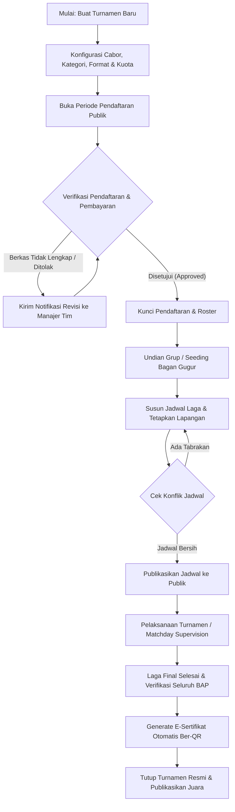
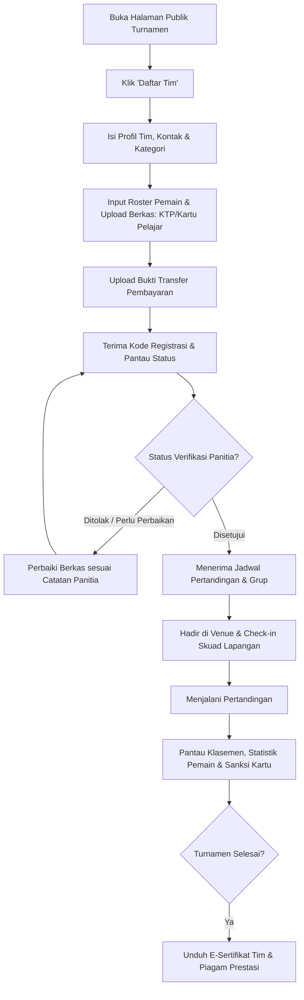
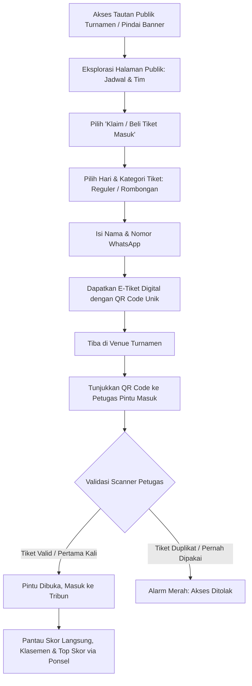
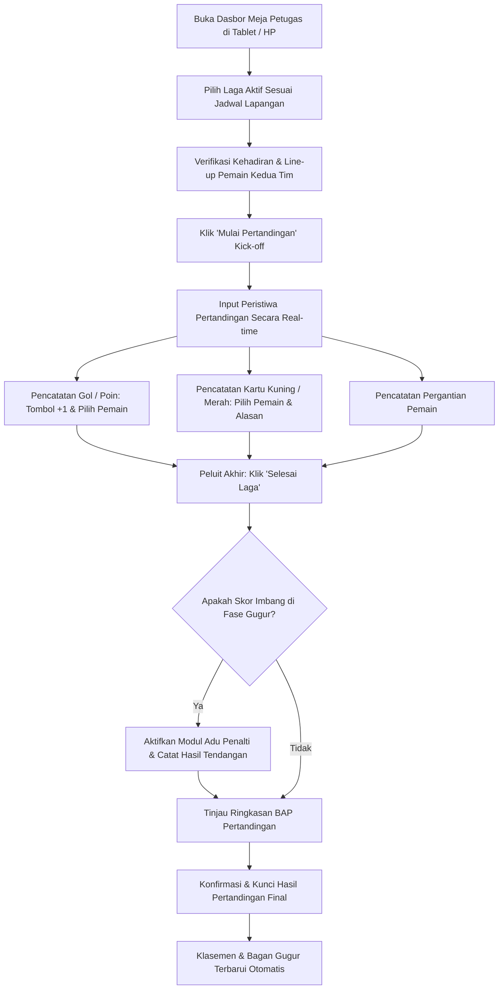
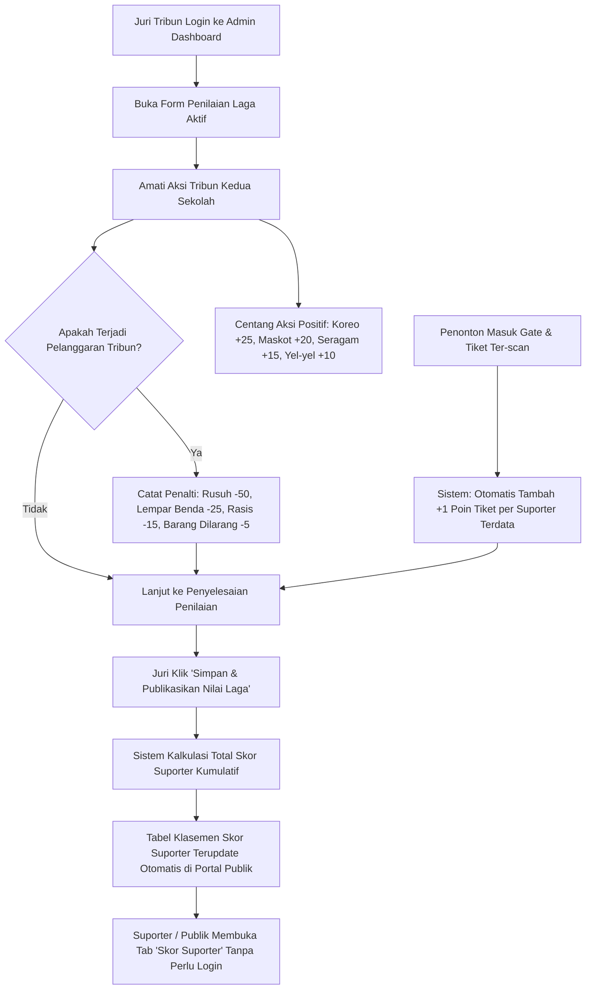

# 05. Alur Pengguna Utama (User Flows)

**Dokumen PRD: Bagian 5/7**  
**Produk:** Sauma Arena  
**Tanggal:** 19 Oktober 2026  
**Referensi:** [00-index.md](./00-index.md) | [02-target-personas.md](./02-target-personas.md) | [04-functional-specs.md](./04-functional-specs.md)

---

## 5.1 Gambaran Umum

Dokumen ini memetakan empat alur pengguna utama (*end-to-end user journeys*) dalam Sauma Arena, yang menghubungkan interaksi antar-peran dari tahap pra-turnamen, hari pelaksanaan laga (*matchday*), hingga pasca-turnamen. Setiap alur dilengkapi diagram alur Mermaid, skenario sukses (*happy path*), dan penanganan skenario khusus (*edge cases*).

---

## 5.2 Alur 1: Penyelenggara Turnamen (Siklus Hidup Turnamen Penuh)

Alur kerja panitia/EO dari inisiasi turnamen hingga penutupan resmi dan distribusi sertifikat.

### Langkah demi Langkah:
1. **Inisiasi Turnamen:** Admin memasukkan nama turnamen, tanggal, logo, deskripsi, lokasi/venue, dan peraturan umum.
2. **Pengaturan Kategori & Format:** Menentukan cabang olahraga (futsal, voli, basket, e-sports), format kompetisi (Grup + Gugur atau Gugur Murni), jumlah kuota tim, dan besaran biaya registrasi.
3. **Verifikasi Peserta:** Admin meninjau data roster dan bukti pembayaran di dasbor verifikasi. Memberikan status *Approved* atau *Rejected* dengan catatan revisi yang jelas.
4. **Pembagian Grup & Bagan:** Melakukan undian tim ke dalam pool grup atau bagan gugur (*bracket*) menggunakan fitur undian otomatis atau slotting manual.
5. **Penjadwalan Bebas Konflik:** Memetakan laga ke slot tanggal, jam, dan nomor lapangan. Sistem otomatis mencegah jadwal ganda pada venue yang sama.
6. **Supervisi Pertandingan:** Memantau dasbor hasil skor yang diinput oleh petugas meja lapangan secara real-time.
7. **Penerbitan Sertifikat & Penutupan:** Mengesahkan hasil final, mencetak laporan akhir, dan menerbitkan e-sertifikat massal ber-QR untuk seluruh pemenang dan peserta.

---

## 5.3 Alur 2: Manajer Tim & Peserta (Pendaftaran hingga Kompetisi)

Alur perjalanan manajer tim atau kapten sekolah dari registrasi awal hingga bertanding dan mengunduh sertifikat prestasi.

### Penanganan Skenario Khusus (Edge Cases):
- **Pemain Terkena Sanksi Akumulasi Kartu:** Jika seorang pemain mengantongi 2 kartu kuning di babak penyisihan, sistem otomatis memblokir centang pemain tersebut pada formulir line-up laga berikutnya. Manajer tim menerima peringatan visual bahwa pemain harus menjalani hukuman 1 laga.
- **Kuota Pendaftaran Penuh:** Formulir pendaftaran otomatis mengunci pengiriman data dan menawarkan opsi bergabung ke *Daftar Tunggu (Waiting List)* jika ada tim yang mengundurkan diri.

---

## 5.4 Alur 3: Penonton & Suporter (Tiket Digital & Pemantauan Laga)

Alur penonton untuk mendapatkan akses masuk venue dan mengikuti perkembangan turnamen favorit.

### Keunggulan Alur:
- **Tanpa Unduh Aplikasi Tambahan:** E-tiket dapat disimpan langsung sebagai tangkapan layar, file PDF, atau dibuka melalui peramban web ponsel.
- **Kecepatan Gate:** Proses pemindaian di pintu masuk berlangsung kurang dari 2 detik per penonton, mencegah penumpukan massa di depan arena.

---

## 5.5 Alur 4: Petugas Meja / Scorer Lapangan (Pencatatan Pertandingan)

Alur kerja petugas meja dan wasit lapangan saat mencatat peristiwa pertandingan secara langsung di pinggir arena.

### Fitur Kritis Petugas Lapangan:
- **Tombol Koreksi Cepat (Undo Event):** Jika petugas salah memasukkan pencetak gol atau menekan tombol skor, tersedia tombol pembatalan aksi (*Undo*) dalam waktu 30 detik sebelum log tersimpan permanen.
- **Dukungan Mode Offline / Jaringan Lemah:** Semua pencatatan skor tetap tersimpan di penyimpanan lokal (*local storage*) perangkat jika jaringan seluler terputus tiba-tiba, dan otomatis diunggah (*sync*) ke server saat koneksi internet kembali normal.

---

## 5.6 Alur 5: Juri Suporter & Penonton (Penilaian & Pemantauan Skor Suporter)

Alur terintegrasi antara penilaian di Admin Dashboard oleh tim pengawas/juri tribun dengan pemantauan real-time suporter di portal publik.

### Langkah demi Langkah:
1. **Akumulasi Tiket Otomatis:** Saat penonton rombongan sekolah memindai tiket di pintu gate, sistem tiket QR otomatis menambah **+1 Poin per Tiket Masuk** ke pundi-pundi poin suporter sekolah tersebut.
2. **Pengisian Form Penilaian oleh Juri di Admin Dashboard:**
   - Juri atau pengawas pertandingan membuka antarmuka khusus di `/admin/tournaments/[id]/supporter-scoring`.
   - Memilih sekolah dan pertandingan yang sedang berlangsung.
   - Menandai checklist aksi kreativitas: Membentang Koreografi (+25), Membawa Maskot Sekolah (+20), Mengenakan Seragam Supporter (+15), dan Menyanyikan Yel-yel Minimal 3 (+10).
3. **Pencatatan Penalti Pelanggaran:**
   - Jika suporter menyalakan flare, melempar botol/benda ke lapangan (-25), menyuarakan ujaran rasis/provokasi (-15), menyelundupkan barang terlarang (-5), atau memicu kericuhan fisik (-50), juri menandai penalti pelanggaran tersebut disertai catatan menit kejadian.
4. **Publikasi & Tampilan Tabel Publik:**
   - Setelah formulir diverifikasi dan disimpan, sistem menggabungkan poin tiket, kreativitas, dan penalti pelanggaran.
   - Tabel Klasemen Skor Suporter pada Halaman Publik & Live Score (Tab `[Skor Suporter]`) seketika memperbarui peringkat seluruh sekolah peserta.
   - Pengunjung umum, siswa, dan guru dapat melihat transparansi rincian perolehan poin setiap saat tanpa memerlukan login.
