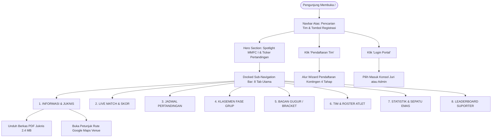
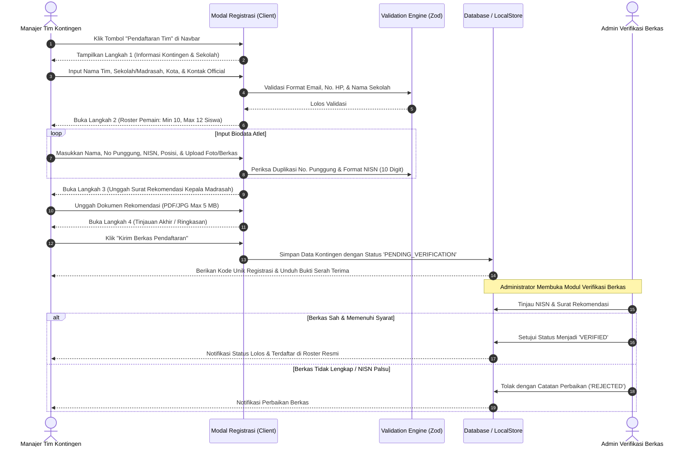
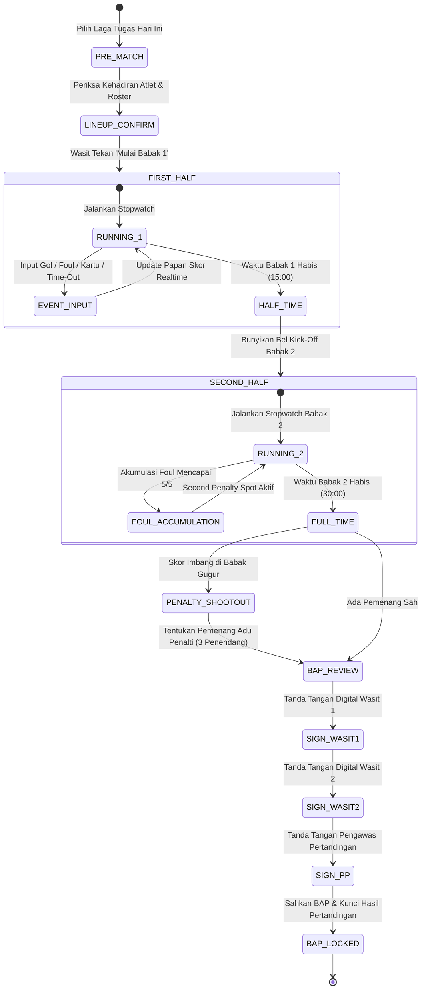
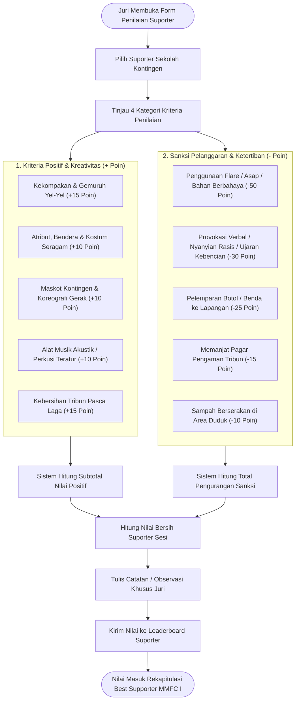
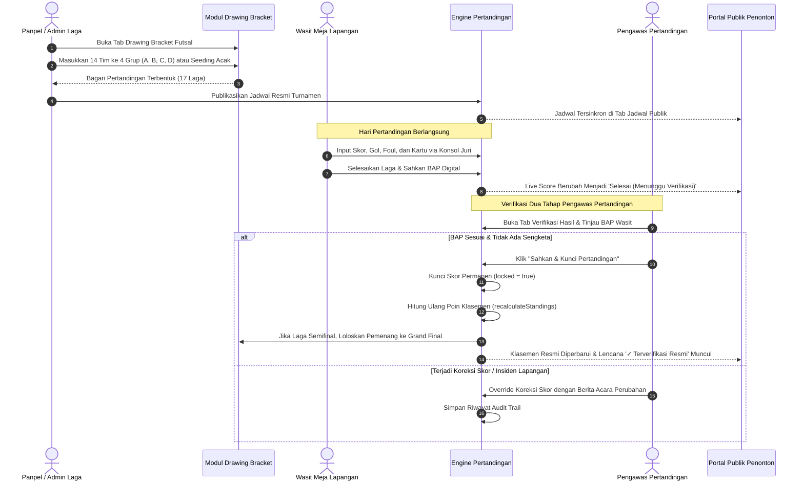
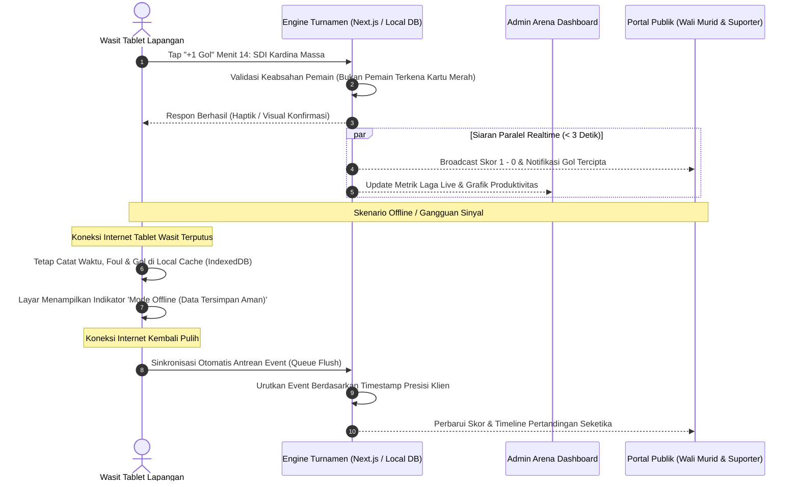

# 05. Spesifikasi Alur Pengguna & Interaksi Operasional Terpadu (User Flows)

**Dokumen PRD — Bagian 05 / 12**  
**Produk:** Sauma Arena — Platform Match Center & Manajemen Turnamen Olahraga Terpadu  
**Edisi Implementasi:** Milad Matsanega Futsal Competition I (MMFC I) • MTsN 3 Blitar  
**Versi Dokumen:** 2.0 (Arsitektur Komprehensif Tiga Konsol: Publik, Wasit Meja, dan Admin Arena)  
**Status:** Disahkan & Tersinkronisasi dengan Kode Sumber (`/src`)

---

## 1. Peta Ekosistem & Matriks Hak Akses Peran (Actor & Role Map)

Platform **Sauma Arena** dirancang untuk melayani tiga kelompok pemangku kepentingan utama:
1. **Publik & Suporter Tribun:** Mengakses informasi jadwal, klasemen, statistik pemain, siaran skor langsung (*live score*), registrasi tim kontingen madrasah/sekolah, serta e-tiket masuk stadion secara instan tanpa hambatan login (*frictionless access*).
2. **Perangkat Pertandingan (Wasit 1, Wasit 2, Pencatat Meja & Juri Suporter):** Mengoperasikan konsol tablet lapangan (*Referee Center*) untuk kendali stopwatch pertandingan (*running clock* vs *stop clock*), pencatatan gol per menit, akumulasi pelanggaran (*fouls* 5/5), time-out, sanksi kartu disiplin, penilaian kreativitas suporter, serta penandatanganan Berita Acara Pertandingan (BAP) digital.
3. **Komisioner & Administrator Arena (Superadmin, Panpel, Pengawas Pertandingan):** Memegang kendali penuh atas manajemen turnamen, verifikasi berkas kontingen atlet, pengesahan hasil BAP dua tahap, generator bagan (*bracket drawing*), live score override, pengaturan kuota tiket gate stadion, hingga ekspor laporan resmi Dispora/Kemenag.

### 1.1 Diagram Hubungan Antar Peran & Arsitektur Alur Data

```mermaid
flowchart TD
    subgraph Aktor["Pemangku Kepentingan (Actors)"]
        PUB["Publik, Wali Murid & Suporter"]
        MAN["Manajer / Pelatih Tim Kontingen"]
        REF["Perangkat Laga (Wasit & Juri Meja)"]
        ADM["Komisioner & Superadmin Arena"]
        SUP["Pengawas Pertandingan & Komdis"]
    end

    subgraph PortalPublik["1. Portal Publik Penonton (Web / Mobile)"]
        P_HERO["Hero Spotlight & Ticker Jadwal"]
        P_INFO["Tab Informasi & Juknis (Bento Grid)"]
        P_LIVE["Tab Live Scoreboard & Match Events"]
        P_SCH["Tab Jadwal & Hasil Pertandingan"]
        P_STD["Tab Klasemen Fase Grup (Grup A - D)"]
        P_BRK["Tab Bagan Eliminasi (Bracket 4 Besar)"]
        P_TIM["Tab Profil Tim & Roster Pemain"]
        P_STA["Tab Statistik & Sepatu Emas (Top Scorer)"]
        P_SUP["Tab Leaderboard Best Supporter"]
        P_REG["Modal Pendaftaran Tim Kontingen"]
        P_TIK["Modal E-Tiket Masuk & QR Gate"]
    end

    subgraph KonsolWasit["2. Konsol Tablet Wasit Lapangan (?view=referee)"]
        R_SEL["Pemilihan Jadwal Laga Tugas Wasit"]
        R_CLK["Stopwatch Digital (Running/Stop Clock)"]
        R_SCR["Pencatat Gol & Pencetak Gol per Menit"]
        R_FUL["Manajemen Foul (5/5) & Time-Out (1 Menit)"]
        R_CRD["Disiplin Kartu (Kuning, Akumulasi 2 KK, Merah Langsung)"]
        R_SUP["Form Penilaian Skor Tribun Suporter"]
        R_BAP["Penyusunan & Pengesahan Digital BAP"]
        R_INS["Form Pelaporan Insiden Khusus Komdis"]
    end

    subgraph AdminArena["3. Panel Admin Arena Komisioner (?view=admin)"]
        M_OVR["Beranda: Metrik Turnamen & Perolehan Medali"]
        M_PREP["Persiapan: Master Cabor, Kategori, Lokasi Venue"]
        M_PART["Peserta: Verifikasi Dokumen NISN & ID Card QR"]
        M_MTCH["Laga: Drawing Bracket, Jadwal & Pengesahan BAP"]
        M_TCKT["Tiketing & Scanner Pintu Masuk Stadion"]
        M_SYST["Sistem: Sinkronisasi Waktu, Banner, Ekspor Dokumen"]
    end

    %% Hubungan Alur Kerja
    PUB -->|Melihat Informasi & Live Score| PortalPublik
    MAN -->|Daftarkan Tim & Unggah Dokumen| P_REG
    PUB -->|Pesan E-Tiket| P_TIK

    REF -->|Input Gol, Waktu & Pelanggaran Lapangan| KonsolWasit
    REF -->|Nilai Kreativitas & Yel-yel| R_SUP
    REF -->|Sahkan Berita Acara Pertandingan| R_BAP

    ADM -->|Verifikasi Berkas Kontingen| M_PART
    ADM -->|Drawing Bagan & Jadwal| M_MTCH
    ADM -->|Konfigurasi Waktu & Banner| M_SYST
    SUP -->|Validasi Akhir BAP & Insiden| M_MTCH

    %% Sinkronisasi Data Realtime
    KonsolWasit -->|Siaran Skor Instan < 3 Detik| P_LIVE
    R_BAP -->|Hasil Masuk Antrean Verifikasi| M_MTCH
    M_MTCH -->|Kunci Skor & Update Klasemen Otomatis| P_STD
    M_MTCH -->|Loloskan Pemenang ke Bagan Semifinal| P_BRK
    R_SUP -->|Akumulasi Poin Suporter| P_SUP
```

---

### 1.2 Matriks Aksesibilitas Halaman & Fitur

| Kode Halaman / Modul | URL / Query View | Hak Akses Utama | Fungsi Inti | Proteksi & Validasi |
| :--- | :--- | :--- | :--- | :--- |
| **Portal Publik** | `/` (Tab default) | Publik (Anonim) | Pusat informasi panduan, juknis, hasil, klasemen & live score | Akses terbuka tanpa autentikasi, anti-lag caching |
| **Registrasi Kontingen** | Modal dari `/` | Manajer Tim SD/MI | Pengisian biodata kontingen, official, dan upload NISN atlet | Validasi format file PDF/JPG, kuota pemain 10-12 atlet |
| **Pemesanan E-Tiket** | Modal dari `/` | Penonton / Suporter | Pemilihan kuota tribun suporter atau penonton umum | Validasi nomor WhatsApp & generate kode booking QR |
| **Konsol Juri Meja** | `/?view=referee` | Wasit & Meja Juri | Kendali stopwatch laga, skor, foul 5/5, time-out, sanksi kartu | Sesi wasit tersimpan, proteksi salah ketuk (*undo void*) |
| **Juri Suporter** | `/?view=referee` (Tab Suporter) | Juri Suporter | Form pencatatan skor atribut, maskot, yel-yel, & sanksi anarkis | Penilaian terikat langsung pada kontingen madrasah |
| **Pengesahan BAP** | `/?view=referee` (Tab BAP) | Wasit 1, Wasit 2, PP | Rekap digital laga, validasi pencetak gol, dan tanda tangan | Tidak dapat diubah setelah disahkan ketiga pihak |
| **Admin Arena Dashboard** | `/?view=admin` | Superadmin / Panpel | Pengaturan cabor, drawing bracket, verifikasi berkas, override skor | Login terenkripsi dengan RBAC (*Role-Based Access Control*) |
| **Verifikasi BAP Dua Tahap**| `/?view=admin` (Submenu Laga) | Pengawas Pertandingan | Memeriksa kecocokan BAP wasit sebelum dikunci permanen | Memicu kalkulasi poin klasemen & bagan gugur |
| **Scanner Tiket Gate** | `/?view=admin` (Submenu Tiket) | Panitia Pintu Masuk | Pemindaian QR tiket pengunjung Gate Barat & Gate Timur | Cegah *double-entry* tiket (+1 Poin Rombongan Suporter) |
| **Pengaturan Durasi Waktu** | `/?view=admin` (Submenu Waktu) | Komisioner Turnamen | Mengatur durasi babak kotor/bersih, batas foul, & sinkronisasi | Nilai default langsung sinkron ke konsol wasit |

---

## 2. Alur Portal Publik Penonton & Suporter (`/`)

Portal publik adalah beranda utama yang beroperasi 24 jam dengan desain *Tactile Athletic Broadcast* bernuansa biru sporty enerjik (`#1D63B8`) dan kontras tinggi. Portal ini menyatukan 8 tab navigasi utama, pencarian kontingen cerdas, serta akses ke formulir registrasi dan tiket.

### 2.1 Peta Navigasi Penonton & Suporter

---

### 2.2 Alur Pencarian Kontingen & Navigasi Cepat (Navbar Search)
1. **Inisiasi Input:** Pengguna mengetik nama sekolah, nama tim, atau kota pada input *search box* di header navbar (misal: `"Kardina"`, `"MIN 7"`, atau `"Srengat"`).
2. **Pencarian Reaktif Klien (*Instant Filtering*):** Tanpa perlu menekan tombol Enter, sistem mencocokkan string secara *case-insensitive* ke 14 daftar kontingen resmi yang tersimpan di memori.
3. **Hasil Dropdown Interaktif:** Muncul kartu pencarian melayang (*floating popover*) yang menampilkan:
   - Logo resmi sekolah/kontingen.
   - Nama lengkap tim dan kontingen madrasah.
   - Lencana grup fase penyisihan (`Grup A`, `Grup B`, `Grup C`, atau `Grup D`).
4. **Navigasi Cepat:** Klik pada hasil pencarian akan langsung menutup dropdown dan membuka tab profil tim bersangkutan.

---

### 2.3 Alur Tab Informasi & Juknis Regulasi (Bento Sport Grid)
Halaman ini menyajikan seluruh ringkasan aturan teknis turnamen dalam grid berstruktur tinggi:
1. **Banner Utama Unduh Juknis (PDF):**
   - Menampilkan judul regulasi resmi: *"Format Turnamen & Regulasi Futsal MMFC I"*.
   - Tombol interaktif **"UNDUH JUKNIS FUTSAL (PDF) • 2.4 MB"** yang memicu animasi unduh tactile dan menampilkan notifikasi konfirmasi berlatar biru sporty.
2. **Kartu Regulasi 1: Durasi & Sistem Waktu (Watermark "30"):**
   - Menginformasikan format waktu resmi: **2 × 15 Menit**.
   - Penjelasan detail: *Waktu kotor (running clock)* pada babak penyisihan grup; *waktu bersih (stop clock)* pada babak gugur/semifinal/final saat bola keluar garis; serta adu penalti 3 penendang jika laga gugur berakhir imbang.
3. **Kartu Regulasi 2: Disiplin & Kartu Wasit (Watermark "2"):**
   - Menampilkan visual kartu wasit bertumpuk miring (Kuning & Merah cerah).
   - Menjelaskan aturan akumulasi: 2 kartu kuning di laga berbeda mengakibatkan sanksi larangan tanding 1 laga berikutnya; kartu merah langsung (KKM) mewajibkan skorsing 1 laga ditambah denda komisi disiplin.
4. **Kartu Regulasi 3: Kategori Penghargaan (Watermark "1·2·3"):**
   - Menampilkan ikon piala emas kejuaraan.
   - Rincian penghargaan: Piala Bergilir MMFC I, Juara 1, 2, 3, Sepatu Emas (*Top Scorer*), Pemain Terbaik (*Best Player*), Suporter Terbaik (*Best Supporter*), serta e-sertifikat resmi ber-QR.
5. **Panduan Venue & Alur Pintu Masuk (Gate Access):**
   - Menyertakan rute Google Maps Lapangan Futsal Seabless Srengat.
   - Peta pembagian pintu: **Gate Barat** (Khusus Atlet, Wasit & VIP ID Card), **Gate Timur 1** (Khusus Rombongan Suporter Madrasah dengan scan tiket rombongan), dan **Gate Timur 2** (Penonton Reguler & Umum).

---

### 2.4 Alur Tab Live Match & Scoreboard Realtime
Halaman ini menyajikan siaran langsung pertandingan lapangan:
1. **Papan Skor Digital Utama:** Menampilkan nama kedua tim, logo sekolah, skor gol besar tabular, babak aktif (`Babak 1`, `Jeda Babak`, `Babak 2`, `Adu Penalti`), serta hitungan mundur menit & detik pertandingan.
2. **Indikator Fouls & Time-Out Lapangan:**
   - Visualisasi 5 lampu indikator pelanggaran tim (*Team Accumulated Fouls*). Jika mencapai 5/5, lampu merah menyala sebagai tanda penalti titik kedua berlaku pada pelanggaran berikutnya.
   - Status penggunaan time-out (1x per babak untuk masing-masing tim).
3. **Perekam Peristiwa Laga (Match Events Timeline):**
   - Menit per menit kronologis gol: nama pemain pencetak gol, nomor punggung, dan jenis gol (*Gol Lapangan*, *Penalti*, atau *Gol Bunuh Diri*).
   - Kronologis kartu kuning dan kartu merah yang diterbitkan wasit lapangan.
4. **Lencana Status Resmi:** Setiap pertandingan aktif diberi lencana berkedip `🔴 LIVE`. Jika laga selesai namun belum diverifikasi pengawas pertandingan, sistem otomatis menyematkan lencana `⚠️ Belum Resmi (Menunggu Verifikasi)`.

---

### 2.5 Alur Tab Jadwal & Hasil Pertandingan
1. **Filter Fase Pertandingan:** Tombol filter cepat untuk beralih antara `Semua Pertandingan`, `Grup A`, `Grup B`, `Grup C`, `Grup D`, `Semifinal`, dan `Grand Final`.
2. **Struktur Kartu Pertandingan:**
   - Nomor Laga (Laga #1 s.d. Laga #17).
   - Waktu & Tanggal (contoh: *Selasa, 3 Nov 2026 • 08:00 WIB*).
   - Lapangan Venue dengan tombol tautan cepat ke Google Maps.
   - Kotak skor kedua tim, pencetak gol utama, dan status pengesahan BAP (`✓ Terverifikasi Resmi`).

---

### 2.6 Alur Tab Klasemen & Kualifikasi Fase Grup
1. **Struktur Klasemen Grup A - D:**
   - 14 Tim dibagi ke dalam 4 grup (Grup A: 3 tim, Grup B: 4 tim, Grup C: 3 tim, Grup D: 4 tim).
   - Kolom metrik: Peringkat, Tim Kontingen, Main (*P*), Menang (*W*), Seri (*D*), Kalah (*L*), Memasukkan (*GF*), Kemasukan (*GA*), Selisih Gol (*GD*), Poin Suporter (*SP*), dan Poin Klasemen (*PTS*).
2. **Aturan Perhitungan Poin Futsal:**
   - Menang = **3 Poin**, Seri = **1 Poin**, Kalah = **0 Poin**.
3. **Penentuan Peringkat (Tie-Breaker):**
   - Total Poin tertinggi $\rightarrow$ Selisih Gol (*Goal Difference*) $\rightarrow$ Produktivitas Gol Memasukkan (*GF*) $\rightarrow$ Head-to-Head $\rightarrow$ Poin Sportivitas/Suporter (*SP*).
4. **Kelolosan Otomatis:** Baris peringkat 1 di setiap grup disorot dengan lencana hijau `Juara Grup Lolos ke Semifinal`.

---

### 2.7 Alur Tab Bagan Gugur (Knockout Bracket)
1. **Visualisasi Bagan 4 Besar (Semifinal & Final):**
   - **Semifinal 1 (Laga #15):** Juara Grup A vs Juara Grup C.
   - **Semifinal 2 (Laga #16):** Juara Grup B vs Juara Grup D.
   - **Perebutan Juara 3 (Bronze Match):** Tim yang kalah di Semifinal 1 vs Tim yang kalah di Semifinal 2.
   - **Grand Final (Laga #17):** Pemenang Semifinal 1 vs Pemenang Semifinal 2.
2. **Propagasi Otomatis:** Saat pertandingan semifinal berstatus `verified`, pemenang otomatis diisi ke slot Grand Final di sistem tanpa input ulang manual.

---

### 2.8 Alur Modal Registrasi Tim Kontingen (Wizard 4 Tahap)

---

## 3. Alur Konsol Juri & Wasit Meja Lapangan (`?view=referee`)

Konsol tablet wasit lapangan dirancang khusus untuk kenyamanan operasional layar sentuh (*touchscreen-first*), kontras tinggi untuk kondisi luar ruangan / GOR, serta meminimalisasi kesalahan ketukan (*anti-misclick protection*).

### 3.1 Peta Siklus Pertandingan Konsol Wasit

---

### 3.2 Alur Stopwatch & Kontrol Waktu Pertandingan
1. **Pemilihan Mode Waktu:**
   - *Fase Grup:* Menggunakan sistem **Waktu Kotor (*Running Clock*)** selama 2 × 15 menit. Waktu tetap berjalan kecuali wasit menginstruksikan time-out resmi.
   - *Fase Gugur (Semifinal & Final):* Menggunakan sistem **Waktu Bersih (*Stop Clock*)**. Stopwatch dijeda (*paused*) seketika saat bola keluar lapangan, terjadi pelanggaran berat, atau wasit meninjau insiden.
2. **Tombol Taktil Kendali Waktu:**
   - **`JALANKAN / JEDA`:** Tombol sentuh besar berwarna hijau/merah di tengah konsol dengan konfirmasi haptik.
   - **`BUNYIKAN BEL`:** Membunyikan sinyal audio kick-off, jeda babak, atau time-out ke pengeras suara arena.
   - **`+1M`:** Tombol koreksi cepat penambahan 1 menit waktu kompensasi / cedera.
   - **`RESET WAKTU`:** Mengatur ulang waktu ke nilai default (15:00) dengan modal konfirmasi ganda agar tidak tertekan secara tidak sengaja.
3. **Sinkronisasi Otomatis:** Durasi babak dan waktu time-out di konsol wasit selalu sinkron dengan pengaturan yang ditentukan administrator pada menu pengaturan pertandingan admin.

---

### 3.3 Alur Pencatatan Skor, Gol, & Pencetak Gol
1. **Aksi Penambahan Gol:** Juri menekan tombol raksasa **`+ 1 GOL`** pada kolom Tim A atau Tim B.
2. **Modal Detail Pencetak Gol:**
   - Menit gol otomatis terisi sesuai angka stopwatch aktif saat tombol ditekan.
   - Juri memilih nama atlet dari daftar pemain yang terdaftar di roster tim bersangkutan.
   - Pilihan jenis gol: *Gol Biasa (Regular Goal)*, *Penalti Titik Pertama (6M)*, *Penalti Titik Kedua (10M / Foul 5+)*, atau *Gol Bunuh Diri (Own Goal)*.
3. **Penyimpanan & Siaran:** Skor gol langsung diakumulasikan ke papan skor utama dan disiarkan ke portal penonton dalam waktu < 3 detik.
4. **Koreksi Kesalahan (*Void / Cancel Goal*):** Jika terjadi anulir gol oleh wasit, juri menekan tombol minus **`-`** atau menghapus baris gol pada tabel riwayat dengan menyertakan alasan pembatalan.

---

### 3.4 Alur Manajemen Pelanggaran Tim (Fouls) & Time-Out
1. **Pencatatan Foul:** Juri menekan tombol **`+`** pada kolom foul tim.
2. **Indikator Akumulasi (1 s.d. 5):**
   - Lampu foul 1–4 menyala kuning sebagai peringatan bagi bangku cadangan dan pelatih.
   - Saat foul ke-5 dicatat, seluruh 5 lampu berubah menjadi merah berkedip, memicu sinyal peringatan wasit: **"Pelanggaran ke-6 dan seterusnya berbuah tendangan penalti titik kedua (10 meter) tanpa pagar betis"**.
3. **Reset Foul Antar Babak:** Sesuai regulasi resmi futsal, akumulasi foul otomatis di-reset menjadi 0 pada awal Babak 2 (kecuali kartu disiplin pribadi pemain yang tetap terakumulasi).
4. **Pencatatan Time-Out:** Masing-masing tim berhak atas 1 kali time-out berdurasi 60 detik di tiap babak. Tombol time-out menghitung mundur 60 detik dan membunyikan bel saat sisa 10 detik.

---

### 3.5 Alur Disiplin Kartu Wasit (Kuning & Merah)
1. **Input Kartu Kuning (KK):** Juri menekan tombol kuning, memilih nama pemain dan menit kejadian.
   - Jika pemain tersebut telah menerima 1 KK sebelumnya pada laga yang sama, sistem otomatis memunculkan peringatan: **"Akumulasi 2 Kartu Kuning $\rightarrow$ Kartu Merah Otomatis (Keluar Lapangan)"**.
2. **Input Kartu Merah Langsung (KKM):** Juri mencatat kartu merah langsung untuk pelanggaran keras / provokatif. Pemain dilarang melanjutkan pertandingan dan tim harus bermain dengan 4 pemain selama 2 menit (atau sampai tim lawan mencetak gol).
3. **Pemberitahuan Komisi Disiplin:** Seluruh penerbitan kartu merah otomatis masuk ke lembar catatan insiden untuk rujukan sidang Komdis pasca laga.

---

### 3.6 Alur Form Penilaian Skor Tribun Suporter oleh Tim Juri

---

### 3.7 Alur Penyusunan & Pengesahan Berita Acara Pertandingan (BAP)
1. **Kompilasi Otomatis Data Pertandingan:** Saat wasit menekan tombol "Selesaikan Laga", sistem merangkum seluruh lembar rekapitulasi:
   - Skor Akhir Babak 1 dan Babak 2 (serta adu penalti bila ada).
   - Daftar pencetak gol lengkap beserta menit dan nomor punggung.
   - Rekap kartu disiplin wasit (Kuning & Merah).
   - Catatan time-out dan foul akumulasi babak 1 & 2.
2. **Pemeriksaan Pratinjau BAP (*Preview Modal*):** Juri meja, Wasit 1, dan Wasit 2 meninjau lembar pratinjau berita acara digital.
3. **Tanda Tangan Tiga Pihak:**
   - *Wasit 1:* Menekan tombol tanda tangan dan mengonfirmasi keabsahan skor.
   - *Wasit 2:* Mengonfirmasi keabsahan catatan pelanggaran dan kartu.
   - *Pengawas Pertandingan (PP):* Menandatangani persetujuan resmi dan menerbitkan kode verifikasi digital BAP.
4. **Status Sah & Kunci:** Setelah ketiga tanda tangan tuntas, BAP berstatus `RESMI_DISAHKAN`. Seluruh perubahan skor dari konsol wasit dikunci permanen untuk mencegah manipulasi.

---

### 3.8 Alur Pelaporan Insiden Khusus & Sanksi Komdis
1. **Pemicu Insiden:** Jika terjadi kericuhan, protes keras pemain/official yang melebihi batas, perusakan fasilitas arena, atau sanksi flare suporter.
2. **Form Laporan Insiden:** Juri memilih tombol **"LAPOR INSIDEN"** pada konsol:
   - Memilih kontingen atau individu terlapor (atlet, pelatih, atau suporter sekolah).
   - Menentukan klasifikasi insiden: *Ringan*, *Sedang*, *Berat*, atau *Keadaan Kahar / Force Majeure*.
   - Menjelaskan kronologi kejadian dan bukti dokumentasi.
   - Merekomendasikan sanksi: *Denda Administratif*, *Diskualifikasi*, atau *Larangan Menghadiri Laga*.
3. **Eskalasi Langsung:** Laporan insiden langsung terkirim ke meja Komisi Disiplin pada modul Admin Arena untuk disidangkan sebelum laga berikutnya dimulai.

---

## 4. Alur Admin Arena Dashboard (`?view=admin`)

Dasbor Admin Arena adalah pusat operasional komisioner turnamen untuk mengelola master data kompetisi, berkas peserta, penjadwalan, verifikasi hasil, tiket stadion, dan konfigurasi sistem.

### 4.1 Peta Struktur Navigasi Admin Arena

```mermaid
flowchart TD
    LOGIN[Login Komisioner / Panpel] --> DASH[Admin Dashboard: Max-W-7xl Centered]

    subgraph ModulBeranda["1. Modul Beranda"]
        DASH --> M1_1[Ringkasan Utama: 4 Metrik Turnamen]
        DASH --> M1_2[Grafik Analisis Gol & Menit Tercipta]
        DASH --> M1_3[Klasemen Perolehan Medali 1-Tap Stepper]
    end

    subgraph ModulPersiapan["2. Modul Persiapan Kompetisi"]
        DASH --> M2_1[Daftar Kompetisi & Freeze Rules Snapshot]
        DASH --> M2_2[Master Cabang Olahraga & Regulasi Cabor]
        DASH --> M2_3[Kategori Kelas & Nomor Tanding]
        DASH --> M2_4[Lokasi Venue & Manajemen Lapangan]
    end

    subgraph ModulPeserta["3. Modul Peserta & Atlet"]
        DASH --> M3_1[Verifikasi Berkas & Validasi Dokumen NISN]
        DASH --> M3_2[Database Atlet & Cetak ID Card Ber-QR]
        DASH --> M3_3[Daftar Tim Kontingen & Official Sekolah]
    end

    subgraph ModulLaga["4. Modul Pertandingan & Wasit"]
        DASH --> M4_1[Bagan & Drawing Bracket Interaktif]
        DASH --> M4_2[Plotting Jadwal & Deteksi Bentrok Wasit]
        DASH --> M4_3[Live Score Override & Darurat Lapangan]
        DASH --> M4_4[Verifikasi BAP Dua Tahap & Pengesahan Hasil]
    end

    subgraph ModulTiket["5. Modul Tiketing & Suporter"]
        DASH --> M5_1[Konfigurasi Kuota Tiket Gate Masuk]
        DASH --> M5_2[Check-in Scanner QR Pintu Masuk Stadion]
        DASH --> M5_3[Rekapitulasi Poin Best Supporter Madrasah]
    end

    subgraph ModulSistem["6. Modul Pengaturan Sistem"]
        DASH --> M6_1[Manajemen Akun Panitia & Hak Akses Role]
        DASH --> M6_2[Pengaturan Waktu Pertandingan Antar-Panel]
        DASH --> M6_3[Kustomisasi Banner Hero & Portal Publik]
        DASH --> M6_4[Cadangkan & Pulihkan Database JSON]
        DASH --> M6_5[Ekspor Laporan Resmi: PDF & Excel]
    end
```

---

### 4.2 Alur Autentikasi, Sesi, & Hak Akses Role Panitia
1. **Halaman Masuk (Auth Gateway):** Panitia membuka modal login dari navbar atas atau URL langsung `/api/auth/login`.
2. **Kredensial & Role:**
   - *Superadmin / Komisioner:* Akses tak terbatas ke seluruh modul persiapan, peserta, override skor, dan pengaturan sistem.
   - *Pengawas Pertandingan:* Hak akses khusus modul verifikasi hasil BAP, laporan insiden komdis, dan plotting jadwal.
   - *Wasit Lapangan / Juri:* Terbatas pada konsol tablet juri lapangan (`?view=referee`).
   - *Petugas Tiketing:* Terbatas pada modul scanner tiket pintu masuk stadion.
3. **Keamanan Sesi:** Sistem memverifikasi sesi melalui cookie HTTP-only dan JWT token dengan masa aktif 24 jam serta opsi logout aman.

---

### 4.3 Alur Modul Beranda & Klasemen Perolehan Medali
1. **Ringkasan Kartu Metrik Utama:**
   - *Total Kontingen:* 14 Tim Kontingen Sekolah Terdaftar.
   - *Total Pertandingan:* 17 Laga (14 Fase Grup, 2 Semifinal, 1 Grand Final).
   - *Status Pertandingan Berjalan:* Papan skor laga live aktif.
   - *Puncak Klasemen Medali:* Kontingen teratas pemegang medali emas.
2. **Grafik Analisis Produktivitas:**
   - *Team Goals Bar Chart:* Distribusi total gol tiap kontingen sekolah.
   - *Goal Minute Line Chart:* Distribusi waktu menit terciptanya gol (Menit 1–10, 11–20, 21–30).
3. **Tabel Klasemen Perolehan Medali 1-Tap:**
   - Tombol stepper cepat `+` dan `-` untuk mencatat perolehan medali Emas, Perak, dan Perunggu tanpa perlu membuka modal formulir yang rumit.
   - Sistem otomatis menghitung total medali dan mengurutkan peringkat kontingen berdasarkan prioritas Emas $\rightarrow$ Perak $\rightarrow$ Perunggu.

---

### 4.4 Alur Modul Persiapan Kompetisi
1. **Daftar Kompetisi & Pembekuan Snapshot Regulasi:**
   - Admin membuat kompetisi baru (misal: *Milad Matsanega Futsal Competition I*).
   - Saat status kompetisi diubah menjadi `ongoing`, sistem membekukan salinan regulasi ke dalam `rules_snapshot` agar perubahan global di masa depan tidak merusak aturan turnamen yang sedang berjalan.
2. **Master Cabang Olahraga & Kategori:**
   - Menentukan cabang olahraga (Futsal), batas usia pelajar (SD/MI se-derajat), kuota roster atlet (10–12 siswa), serta nomor tanding resmi.
3. **Manajemen Lokasi Venue & Lapangan:**
   - Menginput GOR / Arena Futsal (Lapangan Futsal Seabless Srengat), alamat lengkap, kapasitas tribun (500 penonton), dan koordinat Google Maps.

---

### 4.5 Alur Modul Peserta & Verifikasi Berkas Atlet
1. **Pemeriksaan Dokumen Kontingen:**
   - Admin membuka tabel verifikasi berkas kontingen.
   - Memeriksa kelengkapan 3 syarat wajib: NISN resmi Kemdikbud/Kemenag, Surat Rekomendasi Kepala Madrasah, dan Rapor/Ijazah asli.
2. **Keputusan Status Berkas:**
   - **`SETUJUI (VERIFIED)`:** Berkas lengkap dan atlet sah bertanding.
   - **`TOLAK (REJECTED)`:** Menyertakan alasan penolakan (misal: *"NISN tidak ditemukan di pangkalan data Kemenag"*).
   - **`TUNDA (PENDING)`:** Menunggu perbaikan berkas dari official sekolah.
3. **Cetak ID Card Atlet Ber-QR:**
   - Setelah kontingen disetujui, Admin dapat mengekspor dan mencetak lembar ID Card resmi atlet ber-QR code untuk akses pintu masuk stadion Gate Barat.

---

### 4.6 Alur Modul Pertandingan: Drawing Bracket & Verifikasi Dua Tahap

---

### 4.7 Alur Modul Tiketing & Suporter
1. **Manajemen Kuota Gate:**
   - Mengatur kuota harian tiket masuk stadion (misal: 500 tiket/hari).
   - Membagi kategori tiket: Tiket Suporter Rombongan Madrasah dan Tiket Umum.
2. **Scanner Validasi Tiket Gate Masuk:**
   - Petugas gerbang membuka tab Scanner Tiket dengan kamera smartphone atau barcode reader USB.
   - Pindai kode QR pengunjung:
     - Jika tiket valid: Lampu hijau menyala, status tiket beralih menjadi `CHECKED_IN`, dan kuota tiket terpakai bertambah.
     - Jika tiket suporter madrasah: Otomatis menambahkan `+1 Poin Tiket` ke saldo kontingen sekolah suporter bersangkutan.
     - Jika tiket pernah dipakai sebelumnya: Peringatan merah menyala: *"Tiket Sudah Pernah Digunakan pada [Jam:Menit]"*.

---

### 4.8 Alur Modul Pengaturan Sistem
1. **Pengaturan Durasi Waktu Pertandingan:**
   - Menyediakan form input sinkronisasi: Durasi Babak 1 (menit), Durasi Babak 2 (menit), Batas Akumulasi Foul per Babak (default: 5), Batas Time-Out (default: 1 menit), dan Waktu Jeda Babak (*Half-time*).
   - Perubahan langsung tersimpan ke state global turnamen dan menjadi acuan default konsol wasit.
2. **Kustomisasi Banner Hero Publik:**
   - Memilih preset background stadion atau mengunggah gambar kustom.
   - Mengatur slider *Overlay Opacity*, posisi logo (*Offset X/Y*), dan ukuran logo (*Logo Size*).
3. **Cadangkan & Pulihkan Database (Backup / Restore):**
   - **Cadangkan Database:** Mengekspor seluruh snapshot data turnamen (kontingen, pemain, jadwal, skor, klasemen, tiket, dan log insiden) menjadi berkas `.json` terenkripsi.
   - **Pulihkan Database:** Mengunggah berkas JSON cadangan untuk memulihkan sistem secara instan saat terjadi kegagalan perangkat.
4. **Ekspor Laporan Resmi Turnamen:**
   - Mengunduh rekapitulasi Berita Acara Pertandingan (PDF), Lembar Hasil Klasemen Resmi (Excel/PDF), dan Daftar Pencetak Gol Terbanyak Sepatu Emas (PDF) untuk pelaporan formal ke Kemenag dan Dispora.

---

## 5. Alur Sinkronisasi & Pemutakhiran Realtime Lintas Antarmuka

---

## 6. Matriks Validasi Bisnis & Penanganan Kasus Khusus (Edge Cases)

| Skenario Kasus Khusus | Titik Deteksi Sistem | Respon & Tindakan Sistem Sauma Arena | Penanggung Jawab |
| :--- | :--- | :--- | :--- |
| **Skor Imbang di Babak Gugur** | Konsol Wasit & Engine Laga | Waktu 2x15 menit usai dengan skor seri. Sistem otomatis mengaktifkan mode **Adu Penalti (3 Penendang Pertama)**. Bila masih imbang, dilanjutkan sudden death penalti 1 lawan 1 hingga ada selisih gol. | Wasit 1 & Wasit 2 |
| **Akumulasi Foul Mencapai 5** | Konsol Wasit Meja | Saat foul ke-5 dicatat pada salah satu tim dalam 1 babak, sistem membunyikan bel peringatan, menyalakan 5 lampu merah di konsol, dan menampilkan label penalti titik kedua (10M) untuk pelanggaran berikutnya. | Wasit Meja Lapangan |
| **Akumulasi 2 Kartu Kuning Pemain** | Engine Validasi Laga | Saat juri memilih pemain yang sudah mengantongi 1 kartu kuning pada laga yang sama, sistem otomatis mengubah kartu menjadi **Kartu Merah Akumulasi**. Pemain dilarang bermain dan tim bermain 4 orang selama 2 menit. | Wasit Lapangan |
| **Pemain Tidak Sah / Terkena Skorsing** | Form Lineup & Verifikasi | Pemain yang berstatus *suspended* (kartu merah di laga sebelumnya) otomatis berwarna abu-abu dengan label `TERKENA SKORSING` dan tidak dapat dipilih masuk ke dalam susunan pemain laga hari itu. | Pengawas Pertandingan |
| **Pembatalan / Anulir Gol (Void Event)** | Konsol Wasit & Admin Override | Jika wasit lapangan menganulir gol setelah berdiskusi, juri menekan tombol void pada timeline gol, menuliskan alasan anulir, dan sistem menghitung ulang total skor secara transparan tanpa menghilangkan audit trail. | Wasit Meja & Admin |
| **Tiket Masuk Dipindai Ulang (Double Scan)** | Scanner Gate Masuk Stadion | Pemindai menolak akses seketika dengan alarm audio merah: *"Peringatan: Tiket Sudah Digunakan pada Pukul 08:14 WIB"*, mencegah manipulasi duplikasi e-tiket suporter. | Petugas Gate Masuk |
| **Sanksi Kericuhan Suporter Tribun** | Form Penilaian Juri Suporter | Juri suporter dapat mengenakan penalti poin disiplin (misal `-50 Poin` untuk flare atau `-30 Poin` untuk provokasi verbal). Pengurangan langsung memotong skor agregat suporter sekolah di leaderboard publik. | Tim Juri Suporter |

---

## 7. Rangkuman & Kepatuhan Implementasi

Spesifikasi alur pengguna ini menjadi landasan implementasi kode pada antarmuka Sauma Arena:
- **Modularitas Kode:** Seluruh alur terhubung secara bersih antara antarmuka pengguna (`src/components/public/`, `src/components/referee/`, dan `src/components/admin/`) dengan mock data terpusat (`src/mocks/`) serta aturan menu (`src/config/menuConfig.ts`).
- **Integritas Waktu & Skor:** Menjamin tidak ada selisih informasi antara meja wasit lapangan, pengawas pertandingan, dan tampilan publik penonton madrasah.
- **Standar Aksesibilitas:** Mematuhi pedoman WCAG AA dengan rasio kontras warna tinggi, navigasi ramah sentuhan, dan performa tinggi tanpa lag.
