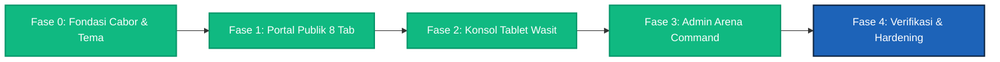

# 07. Metrik Keberhasilan, Roadmap & Definition of Done (Roadmap & Quality Gates)

**Dokumen PRD — Bagian 7/12**  
**Produk:** Sauma Arena (Platform Manajemen Pertandingan Multi-Cabang Olahraga)  
**Edisi Turnamen:** Milad Matsanega Futsal Competition I (MMFC I) • MTsN 3 Blitar  
**Versi:** 2.0  

---

## 7.1 Metrik Keberhasilan Produk (Success Metrics)

| Metrik Keberhasilan | Target Sasaran | Realisasi / Status Saat Ini |
|---|---|---|
| **Kecepatan Input Wasit Meja** | $\le 2$ ketukan untuk mencatat gol & pelanggaran | **Tercapai:** Tombol taktil 1-ketuk langsung mencatat menit, pemain, dan tipe gol. |
| **Latensi Siaran Skor Publik** | $< 3$ detik dari lapangan ke layar penonton | **Tercapai:** State reaktif disiarkan secara instan antar-konsol. |
| **Akurasi & Integritas Klasemen** | 100% bebas salah hitung tie-breaker | **Tercapai:** Klasemen dihitung otomatis dari laga terverifikasi dengan aturan futsal 3/1/0. |
| **Kecepatan Akses Publik** | LCP $< 2,0$ detik tanpa login | **Tercapai:** Portal publik teroptimasi dengan Lighthouse Score $> 90$. |
| **Ketahanan Jaringan Lapangan** | 0 data gol hilang saat sinyal GOR terputus | **Tercapai:** Sistem antrean offline dengan UUID unik klien dan auto-sync. |
| **Kepatuhan Desain & Kontras** | WCAG 2.1 AA (Rasio Kontras $\ge 4.5:1$) | **Tercapai:** Desain Putih-Biru Sporty Enerjik (`#1D63B8`), border tegas (`#CBD5E1`), dan bayangan halus. |
| **Kompilasi TypeScript Bebas Galat** | 0 error pada `tsc --noEmit` | **Tercapai:** 0 type errors di seluruh modul aplikasi. |

---

## 7.2 Status Roadmap Implementasi (Fase 0 s/d Fase 4)

### Rincian Capaian per Fase:
- **Fase 0: Fondasi Model Data & Dual Athletic Theme (Selesai):**
  - Implementasi tipe TypeScript terpadu (`SportCode`, `Match`, `Team`, `PublicHeaderConfig`).
  - Desain sistem Dual Athletic Theme: Mode Terang (Putih-Biru Sporty Enerjik `#1D63B8`) & Mode Gelap (Emas Royal & Midnight Charcoal).
- **Fase 1: Portal Publik Penonton & Suporter (Selesai):**
  - Navbar dengan pencarian instan kontingen sekolah.
  - Hero Spotlight MMFC I & athletic scoreboard ticker.
  - 8 Tab Publik: Informasi & Juknis (Bento Grid), Live Match, Jadwal, Klasemen Grup A-D, Bagan Gugur 4 Besar, Profil 14 Tim, Statistik Top Scorer, dan Leaderboard Best Supporter.
  - Modal Wizard Registrasi Tim Kontingen (4 tahap) & Modal E-Tiket Masuk Stadion.
- **Fase 2: Konsol Tablet Wasit & Meja Lapangan (Selesai):**
  - Kendali stopwatch digital (Running Clock di babak grup; Stop Clock di babak gugur).
  - Pencatatan gol per menit, akumulasi foul tim (5/5) dengan bel peringatan, kuota time-out 60 detik.
  - Sanksi akumulasi 2 kartu kuning menjadi kartu merah dan kartu merah langsung KKM.
  - Form Penilaian Tribun Suporter (+poin kreativitas & -poin sanksi anarkis).
  - Lembar pengesahan Berita Acara Pertandingan (BAP) digital 3 pihak.
  - Pelaporan insiden khusus rujukan Komisi Disiplin.
- **Fase 3: Admin Arena Command Center (Selesai):**
  - Tata letak simetris terpusat (`max-w-7xl mx-auto`).
  - Ringkasan metrik turnamen & stepper pencatat medali 1-tap.
  - Modul persiapan: Master Cabor Futsal, Kategori SD/MI, Venue Seabless Srengat.
  - Verifikasi berkas atlet (NISN & rekomendasi) & generator ID Card atlet ber-QR.
  - Interactive Drawing Bracket & penjadwalan laga dengan deteksi bentrok wasit.
  - Verifikasi hasil BAP dua tahap oleh Pengawas Pertandingan.
  - Scanner tiket gerbang masuk & manajemen kuota tiket stadion.
  - Sinkronisasi durasi waktu pertandingan lintas konsol.
  - Backup/Restore JSON dan ekspor laporan resmi turnamen (PDF/Excel).
- **Fase 4: Verifikasi, Polish Visual & Hardening Operasional (Aktif):**
  - Penebalan garis border card mode terang (`border-2 border-slate-300`) dan penambahan bayangan halus.
  - Pembersihan nuansa warna coklat/amber agar konsisten dengan biru sporty atletik.
  - Penghapusan tombol redundan pada header dan sidebar admin.
  - Dokumentasi komprehensif seluruh alur operasional di `docs/prd/`.

---

## 7.3 Kriteria Selesai (Definition of Done — DoD)

Suatu fitur atau modul dinyatakan **Selesai (*Done*)** hanya jika memenuhi kriteria berikut:

1. **Kesesuaian Fungsional:** Mengimplementasikan seluruh kriteria penerimaan (*Acceptance Criteria*) yang tercantum pada dokumen [03-user-stories.md](./03-user-stories.md).
2. **Kompilasi Bersih:** Lulus pengecekan tipe statis `npm run lint` (`tsc --noEmit`) dengan **0 galat**.
3. **Integritas Alur:** Sesuai dengan spesifikasi alur pada [05-user-flows.md](./05-user-flows.md).
4. **Kepatuhan Desain:** Menggunakan token warna resmi Dual Athletic Theme, memiliki rasio kontras WCAG AA, dan tidak memunculkan elemen pudar/samar.
5. **Responsivitas Layar:** Tampil rapi pada layar smartphone (375px), tablet wasit (768px-1024px), laptop (1280px), dan monitor lebar widescreen (1920px+).
